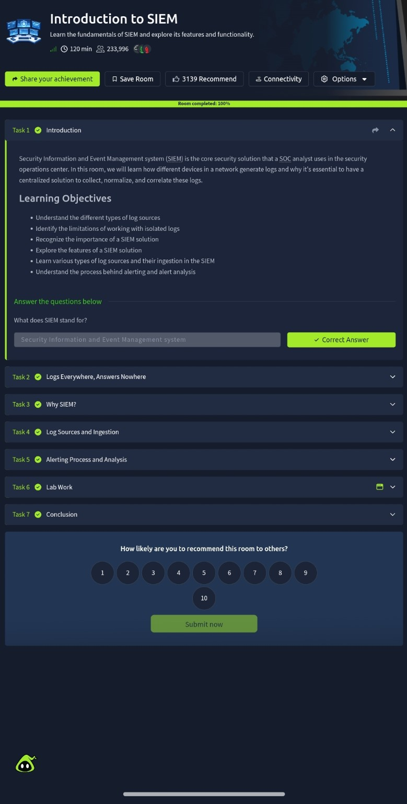
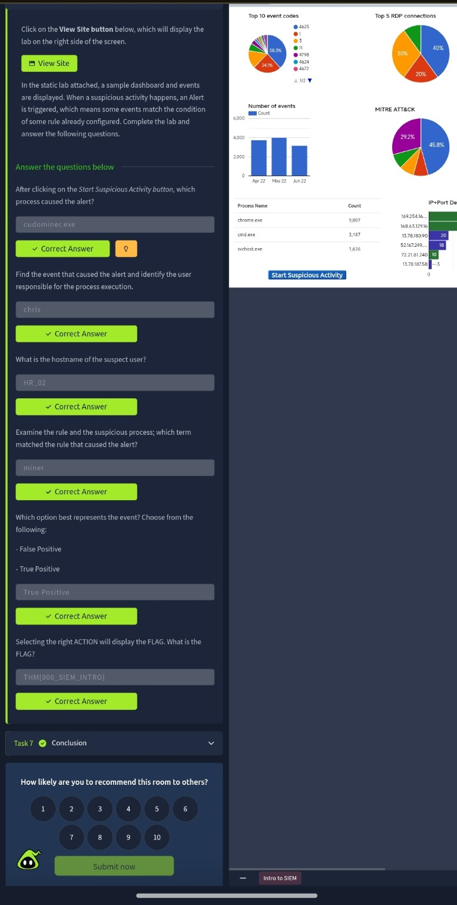
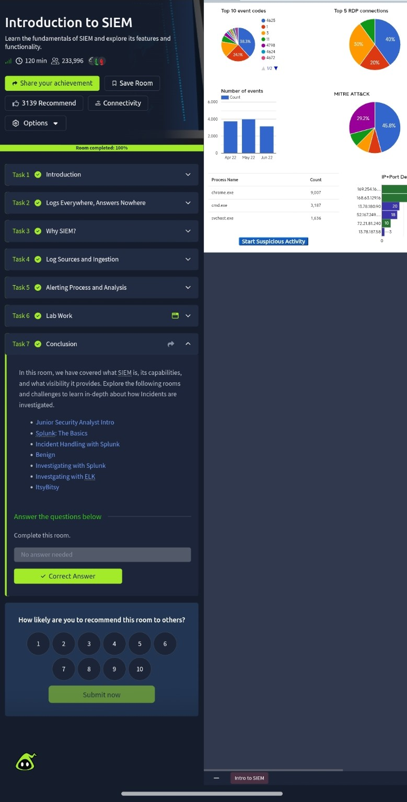

# TryHackMe: Introduction to SIEM

> A beginner-friendly walkthrough of SIEM fundamentals, log sources, log ingestion, alerting, and basic alert investigation.

## Room Overview

| Field | Details |
|---|---|
| Platform | TryHackMe |
| Room | Introduction to SIEM |
| Difficulty | Introductory |
| Estimated time | 120 minutes |
| Status | Completed (100%) |
| Focus | SIEM fundamentals, log sources, ingestion, correlation, alert analysis |

## Learning Objectives

By completing this room, I learned to:

- Understand different types of log sources.
- Identify the limitations of working with isolated logs.
- Explain why a SIEM solution is important.
- Explore common SIEM capabilities.
- Understand log sources and how logs are ingested into a SIEM.
- Follow the alerting process and perform basic alert analysis.



## 1. What is SIEM?

**SIEM** stands for **Security Information and Event Management**.

A SIEM solution is a core security platform used by a Security Operations Center (SOC). It collects logs from multiple sources, brings them into a centralized location, and helps analysts identify suspicious activity by searching, analyzing, and correlating events.

Without centralization, an analyst may need to access many individual systems to investigate an incident. A SIEM makes this process more manageable by providing a common place to examine events from endpoints, servers, network devices, and other systems.

## 2. Log Sources

Devices and applications continuously generate records of activity. These records are called **logs**, and the systems that generate them are known as **log sources**.

The room groups log sources into two main categories.

### 2.1 Host-Centric Log Sources

Host-centric logs record activities that occur on, or are related to, an individual host. Examples include:

- A user accessing a file.
- A user attempting to authenticate.
- A process executing.
- A process adding, editing, or deleting a registry key or value.
- PowerShell execution.

Examples of host-centric sources include Windows systems, Linux systems, and servers.

### 2.2 Network-Centric Log Sources

Network-centric logs record network-related activity, such as communication between hosts or access to internet resources.

Examples include:

- SSH connections.
- A file being accessed through FTP.
- Web traffic.
- A user accessing company resources through a VPN.
- Network file-sharing activity.

Firewalls, IDS/IPS devices, and routers are examples of devices that can generate network-centric logs.


## 3. Why Are Logs Not Enough on Their Own?

Having logs available does not automatically make an investigation easy. The room highlights several challenges when logs are scattered across different systems.

### 3.1 Numerous Log Sources

A network can contain many log sources, each generating a large number of events. Reviewing each source individually can become time-consuming.

### 3.2 No Centralization

When logs remain on the systems that generated them, analysts may need to connect to each system separately using methods such as SSH or RDP. This makes investigations inefficient.

### 3.3 Limited Context

An individual event may look harmless when viewed alone. Correlating events from different sources can reveal a larger sequence of activity.

For example, a file-access event may initially appear normal. When correlated with authentication activity and events from another machine, it may help reveal unauthorized access or lateral movement.

### 3.4 Limited Analysis

The volume of events generated by a network makes manual analysis difficult. Important activity can be missed when analysts have to review large amounts of data individually.

### 3.5 Format Issues

Different log sources use different formats. Analysts need a consistent way to interpret and compare events from different systems.

## 4. Why Use a SIEM?

A SIEM addresses these challenges by providing a centralized platform for collecting and analyzing security events.

### 4.1 Centralized Log Collection

Logs from endpoints, servers, firewalls, and other sources are collected in one place. They can be sent through lightweight agents or APIs and made available in the SIEM platform.

### 4.2 Log Normalization

Raw logs may have different structures and formats. **Normalization** converts log data into a consistent structure with common fields, making it easier to search and analyze.

The room describes parsing as breaking a log into separate fields, and normalization as converting logs from different sources into a consistent format.

### 4.3 Log Correlation

Correlation connects related events from different sources to provide context.

The room gives an example involving a user named Haris:

1. Haris logs in through a VPN from an IP address he has never used before.
2. Haris accesses documents on a shared drive.
3. Haris executes a PowerShell script.
4. The system makes an outbound network connection.

Each event viewed separately may not tell the whole story. When correlated within a short time window, the sequence could indicate possible data exfiltration following the compromise of VPN credentials.

### 4.4 Real-Time Alerting

SIEM detection rules identify activity that matches configured conditions. When the conditions are met, an alert is generated and analysts are notified so they can investigate.

Analysts can also create or modify rules based on their detection requirements.

### 4.5 Dashboards and Reporting

Dashboards present collected and analyzed information in a visual and actionable format.

Examples of dashboard information include:

- Alert highlights.
- System notifications.
- Health alerts.
- Failed login attempts.
- Number of ingested events.
- Triggered rules.
- Top domains visited.

The room also mentions other SIEM capabilities, including threat-intelligence integration, data retention, and searching.


## 5. Alerting Process and Analysis

A SIEM alert is generated when activity matches the conditions of a detection rule.

A basic investigation workflow is:

1. Identify the alert and the rule that triggered it.
2. Review the associated event details.
3. Identify the affected process, user, and host.
4. Examine the event context to understand why the rule matched.
5. Decide whether the activity is a true positive or a false positive.
6. Select the appropriate response action based on the findings.

**True Positive:** The alert correctly identifies suspicious or malicious activity.

**False Positive:** The alert is triggered by activity that is not actually malicious.

An alert should not be treated as proof of compromise without reviewing its supporting evidence and context.

## 6. Practical Lab: Investigating a Suspicious Activity Alert

In the lab, I used the provided dashboard and triggered the suspicious activity scenario using the **Start Suspicious Activity** button.

The lab generated an alert that could be investigated using the event information and the configured detection rule.

### Investigation Findings

| Question | Finding |
|---|---|
| Process responsible for the alert | `cudominer.exe` |
| User responsible for execution | `chris` |
| Suspect user's hostname | `HR_02` |
| Term matched by the detection rule | `miner` |
| Event classification | True Positive |
| Flag | `THM{000_SIEM_INTRO}` |

### Investigation Notes

- The suspicious process was identified as `cudominer.exe`.
- The associated user was `chris`.
- The hostname linked to the suspect user was `HR_02`.
- The detection rule matched the term `miner`.
- The lab classified the event as a **True Positive**.
- The completed investigation revealed the room flag: `THM{000_SIEM_INTRO}`.



### Dashboard Observations

The lab dashboard provided several visual summaries of the available event data, including:

- Top event codes.
- Top RDP connections.
- Number of events over time.
- MITRE ATT&CK-related event distribution.
- Process names and their event counts.
- IP and port-related information.

These panels provide an overview of activity and can help an analyst decide where to investigate further. The dashboard is a starting point; the underlying events and detection rule still need to be examined.



## 7. Key Takeaways

After completing this room, the main concepts I took away were:

1. **Logs provide visibility:** Hosts and network devices record activities that can be useful during security investigations.
2. **Centralization matters:** Collecting logs in one place reduces the need to investigate every system separately.
3. **Normalization improves analysis:** A consistent log structure makes searching and comparing events easier.
4. **Correlation adds context:** Events that appear harmless individually may reveal suspicious behavior when viewed together.
5. **Alerts need investigation:** Analysts must review the process, user, host, rule, and surrounding activity before deciding how to classify an alert.
6. **Dashboards support triage:** Visual summaries help identify patterns and prioritize investigation, but they do not replace event analysis.

## 8. Further Learning

The room recommends exploring these related TryHackMe rooms:

- Junior Security Analyst Intro
- Splunk: The Basics
- Incident Handling with Splunk
- Benign
- Investigating with Splunk
- Investigating with ELK
- ItsyBitsy

Search for these titles on [TryHackMe](https://tryhackme.com/) to find their current room pages.

## Conclusion

This room introduced the fundamentals of Security Information and Event Management and explained why collecting logs alone is not enough. Centralized collection, normalization, correlation, alerting, and dashboards help SOC analysts turn large volumes of event data into useful security information.

The practical lab reinforced the importance of examining the process, user, hostname, and detection-rule match instead of relying only on the alert title.

**Room status: Completed (100%).**

---

## Repository Structure

Keep the Markdown file and its `images` directory together so that the screenshots render correctly on GitHub:

```text
THM-Introduction-to-SIEM/
├── README.md
└── images/
    ├── 01-room-overview.jpg
    ├── 02-log-sources-and-challenges.jpg
    ├── 03-siem-features.jpg
    ├── 04-lab-alert-investigation.jpg
    └── 05-lab-dashboard-and-conclusion.jpg
```

## Disclaimer

This writeup documents my learning and lab observations from the TryHackMe room. All practical activity described here was performed in the provided training environment.
